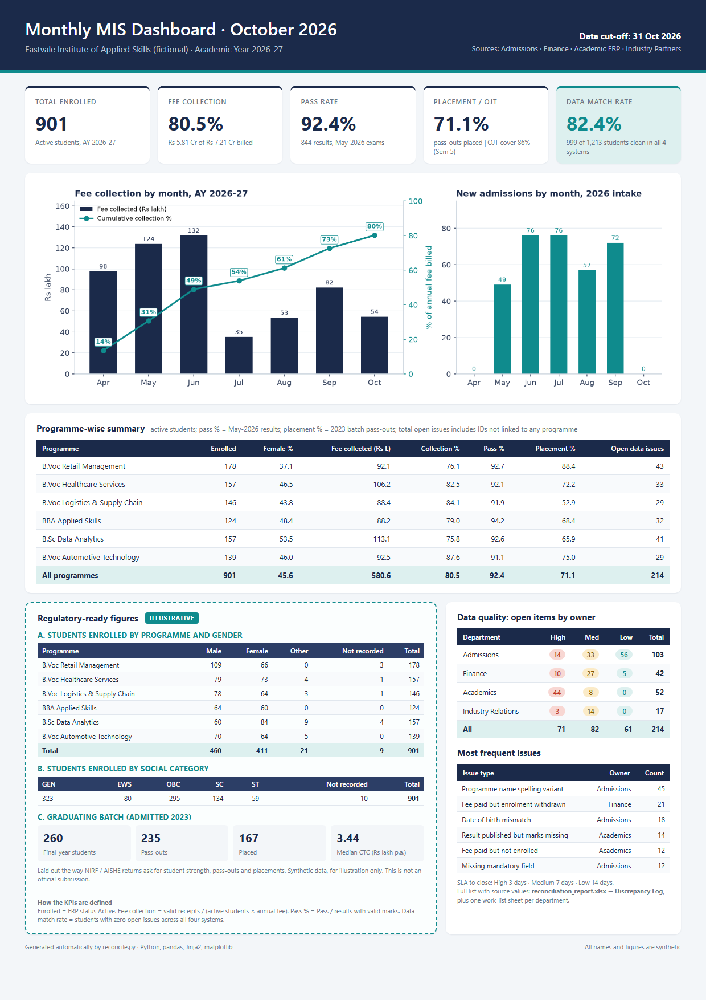

# Multi-Source Data Reconciliation & Monthly MIS

**Four university systems that should agree about every student, checked against each other automatically. Every mismatch is logged and sent to the department that owns it, and a one-page monthly MIS dashboard is produced at the end.**



*The dashboard above is generated by the script. Full PDF: [`output/monthly_mis_dashboard.pdf`](output/monthly_mis_dashboard.pdf). Discrepancy workbook: [`output/reconciliation_report.xlsx`](output/reconciliation_report.xlsx).*

> All data in this project is **synthetic**. The institute (*Eastvale Institute of Applied Skills*), students, industry partners and figures are fictional and randomly generated.

---

## Problem → What I built → Result

**Problem.** A university or skills institute keeps student data in several places. Admissions has its register, Finance has fee receipts, the Academic ERP has enrolment and exam results, and Industry Relations tracks on-the-job training (OJT) and placements. These systems drift apart: a student is admitted but never created in the ERP, a fee is paid for someone who isn't enrolled, a programme is typed three different ways, dates of birth disagree. Monthly MIS figures and regulatory returns (NIRF / AISHE style) are then built on numbers that don't match.

**What I built.** A repeatable Python process that:

1. **Checks each system on its own** for blank mandatory fields, duplicates, wrong formats and impossible values.
2. **Matches the four systems on Student ID** (like SQL joins) and flags every disagreement.
3. **Classifies each problem** by type and severity and **assigns it to the owning department** (Admissions, Finance, Academics or Industry Relations), with a target close date.
4. **Produces an Excel workbook** with a summary, a full discrepancy log, one work-list per department, a clean master data sheet and a data dictionary.
5. **Produces a one-page monthly MIS dashboard** (HTML, PDF and PNG) with KPIs, a programme-wise table, a monthly trend chart and an illustrative regulatory-ready block.

**Result (on the sample data: 1,200 students, about 4,200 source rows).**

| | |
|---|---|
| Unique student IDs checked across 4 systems | **1,213** |
| Discrepancies found and logged | **214** (71 high severity) |
| Students fully matched in every system | **82.4%** |
| Planted test problems caught | **193 / 193 (100%)** |
| Clean, validated master records | **999** |
| Time to rerun the whole month | **about 30 seconds** |

---

## Checks performed (in plain words)

**Inside each system (validation)**

- Required fields left blank (gender, category, date of birth, programme, and so on)
- The same Student ID used twice, either as an exact copy or by two different people
- The same fee receipt entered twice, so money is counted double
- E-mail addresses without an "@", and phone numbers that aren't 10 digits
- Student IDs typed with the wrong case or stray spaces
- Dates that don't exist (for example 31 September)
- Ages at admission that make no sense (under 16 or over 45)
- Negative fee amounts (a reversal posted as a receipt)
- Exam marks higher than the maximum, or "Pass/Fail" that contradicts the marks
- Result shown as published but the marks are missing
- OJT end date earlier than the start date
- Industry partner not on the approved partner (MoU) list

**Across systems (reconciliation)**

- Admitted, but missing in the Academic ERP
- Fee paid, but the student is not enrolled
- Fee paid, but the student has withdrawn (a refund needs checking)
- In the ERP, but no admission record
- Fee receipt or placement record for a student ID nobody recognises
- Same programme spelled differently ("BVoc Retail Mgmt" vs "B.Voc Retail Management")
- Student shown in a different programme in each system
- Date of birth or name that differs between Admissions and the ERP

Each item gets an **owner department**, a **severity** (High, Medium or Low) and a **target close date** (3, 7 or 14 days).

---

## What's in the Excel report

| Sheet | What it shows |
|---|---|
| **Summary** | Headline counts, % of records fully matched, counts by issue type and by department, stacked bar chart |
| **Discrepancy Log** | Every issue: ID, student, issue, value in source A, value in source B, owner, severity, status, raised on, target close date |
| **Admissions / Finance / Academics / Industry Relations** | Each department's own filtered work-list |
| **Master Data** | 999 clean student records that passed every check, combined from all four systems |
| **Data Dictionary** | What every column means, including the source files |

## What's on the dashboard

- **KPI cards:** total enrolled, fee collection %, pass %, placement / OJT %, data match rate
- **Monthly trend:** fee collected per month with cumulative collection %, plus new admissions by month
- **Programme-wise table:** enrolment, female %, fees, pass %, placement %, open data issues
- **Regulatory-ready figures (illustrative):** students by programme × gender, students by social category, pass-outs, placements and median salary, laid out the way NIRF / AISHE returns ask for them
- **Data quality:** open items by department and severity, and the most frequent issue types

---

## Skills shown

- **Excel-style reporting:** formatted workbook, filters, frozen headers, conditional formatting, native Excel chart, data dictionary
- **SQL-style joins with pandas:** matching records across systems on a key (inner and anti joins, group-bys, pivots)
- **Data validation:** mandatory fields, duplicates, formats, ranges, reference-list checks
- **Reconciliation:** finding and classifying disagreements between systems of record
- **Discrepancy tracking:** issue log with owner, severity, SLA and status, ready for follow-up
- **Dashboarding:** KPI design, trend chart (matplotlib), print-ready one-page MIS (HTML to PDF)
- **Automation:** the whole month reruns with one command, and results are reproducible with a fixed seed

---

## How to run

```bash
pip install -r requirements.txt
python generate_sample_data.py     # creates the synthetic CSVs in data/
python reconcile.py                # writes output/ and docs/dashboard_preview.png
python reconcile.py --as-of 2026-10-31   # choose the MIS cut-off date
```

The PDF and PNG are rendered with headless Google Chrome. If Chrome is not in the default Windows location, set the `CHROME_PATH` environment variable. Without Chrome, the HTML dashboard and Excel report are still produced.

```
data/        synthetic source extracts + programme and partner master lists
templates/   Jinja2 HTML template for the dashboard
output/      reconciliation_report.xlsx, monthly_mis_dashboard.html / .pdf, monthly_trend.png
docs/        dashboard_preview.png (used above)
tests/       expected_issues.csv: the problems deliberately planted in the data; reconcile.py reports how many it caught
```
